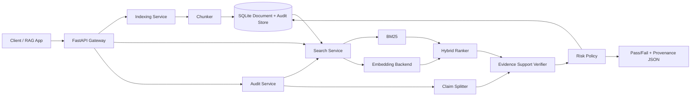

# VeriRAG

[](https://github.com/sattipraveena3-sudo/veritrag/actions/workflows/ci.yml)
[](https://www.python.org/)
[](LICENSE)

**Evidence-first reliability gateway for RAG and LLM applications.** VeriRAG ingests trusted knowledge, performs hybrid retrieval, audits generated answers claim-by-claim, stores provenance, and exposes a CI-friendly pass/fail risk gate.

> The project is intentionally model-provider neutral. The default hashing backend is deterministic and lightweight for CI. A sentence-transformer backend can be enabled for denser semantic retrieval without changing application code.

## Why VeriRAG exists

RAG applications can retrieve plausible text and still produce unsupported answers. Many teams inspect examples manually or evaluate only end-to-end answer similarity. VeriRAG inserts a dedicated reliability layer between generated text and production: each answer is decomposed into claims, matched against retrieved evidence, scored for support, and assigned a risk score with machine-readable provenance.

## Demo

```bash
python -m venv .venv
source .venv/bin/activate
pip install -e ".[dev]"
cp .env.example .env

veritrag ingest examples/company_policy.txt   --source-id acme-policy   --title "Acme Cloud Policy"

veritrag search "Enterprise priority-one response time" --top-k 3

veritrag audit   --question "What response time does Enterprise support target for priority-one incidents?"   --answer "Enterprise support targets a one-hour response time for priority-one incidents."   --fail-on-risk
```

`--fail-on-risk` exits with code `2` when an answer does not meet the configured evidence threshold, so it can be used in CI, evaluation pipelines, or pre-deployment checks.

## Architecture



## Features

- Idempotent document ingestion using stable `source_id` values.
- Overlapping production-style text chunking.
- Custom BM25 implementation plus vector retrieval.
- Pluggable embedding backends using a typed protocol.
- Claim-level evidence support scoring.
- Negation-mismatch penalty to reduce obvious contradiction false positives.
- Explainable risk score and strict pass/fail quality gate.
- Persistent audit records for traceability.
- REST API and CLI surfaces.
- SQLite persistence with zero external infrastructure for the default deployment.
- Docker image, Compose file, linting, strict type checking, tests, coverage, and GitHub Actions CI.
- Optional sentence-transformer backend.

## Installation

### Local development

```bash
git clone https://github.com/sattipraveena3-sudo/veritrag.git
cd veritrag
python -m venv .venv
source .venv/bin/activate
python -m pip install --upgrade pip
pip install -e ".[dev]"
make check
```

### Optional semantic backend

```bash
pip install -e ".[semantic]"
export VERITRAG_EMBEDDING_BACKEND=sentence-transformer
export VERITRAG_SENTENCE_MODEL=sentence-transformers/all-MiniLM-L6-v2
```

### Docker

```bash
docker compose up --build
```

API docs are then available at `http://localhost:8000/docs`.

## REST usage

### 1. Ingest a document

```bash
curl -X POST http://localhost:8000/v1/documents   -H 'content-type: application/json'   -d '{
    "source_id": "acme-policy",
    "title": "Acme Cloud Policy",
    "text": "Enterprise support targets a one-hour response time for priority-one incidents."
  }'
```

### 2. Search trusted evidence

```bash
curl -X POST http://localhost:8000/v1/search   -H 'content-type: application/json'   -d '{"query":"enterprise incident response", "top_k":5}'
```

### 3. Audit an LLM answer

```bash
curl -X POST http://localhost:8000/v1/audits   -H 'content-type: application/json'   -d '{
    "question":"What is the Enterprise priority-one response target?",
    "answer":"Enterprise support targets a one-hour response time for priority-one incidents.",
    "top_k":6
  }'
```

A response contains `risk_score`, `passed`, `supported_claim_ratio`, every extracted claim, the strongest supporting chunk, component scores, and the retrieved evidence set.

## Configuration

| Variable | Default | Purpose |
|---|---:|---|
| `VERITRAG_DB_PATH` | `./veritrag.db` | SQLite database path |
| `VERITRAG_EMBEDDING_BACKEND` | `hashing` | `hashing` or `sentence-transformer` |
| `VERITRAG_SENTENCE_MODEL` | `all-MiniLM-L6-v2` | Optional semantic model |
| `VERITRAG_CHUNK_SIZE` | `900` | Chunk size in characters |
| `VERITRAG_CHUNK_OVERLAP` | `120` | Character overlap |
| `VERITRAG_MIN_SUPPORT_SCORE` | `0.48` | Per-claim support threshold |
| `VERITRAG_MAX_RISK_SCORE` | `0.45` | Maximum passing audit risk |

## Engineering decisions

**Why hybrid retrieval?** Lexical retrieval is strong on identifiers, policy terms, and exact numbers; vector retrieval is better at paraphrases. VeriRAG normalizes both signals and combines them rather than betting on a single retriever.

**Why persist audit payloads?** Production AI incidents are difficult to reproduce when only final answers are logged. The audit record stores the question, answer, evidence ranking, claim-level support, and policy result.

**Why a lightweight default embedder?** CI should not download a large model or require a GPU. The deterministic hashing backend makes tests and container builds fast. Teams can opt into sentence-transformers for stronger semantics.

## Validation

The v0.1.0 release acceptance run passes **9/9 tests at 86% statement coverage**. The end-to-end demo verifies that an evidence-supported one-hour response-time claim passes the gate while a contradictory ten-minute claim fails with a numeric-fact-mismatch penalty. See [`docs/VALIDATION_REPORT.md`](docs/VALIDATION_REPORT.md) for the recorded release validation.

## Development

```bash
make install
make lint
make typecheck
make test
make check
```

## Roadmap

- [ ] Add NLI-based entailment/contradiction verification as a first-class backend.
- [ ] Add PostgreSQL + pgvector repository implementation.
- [ ] Add OpenTelemetry traces and Prometheus metrics.
- [ ] Add signed provenance records for regulated workflows.
- [ ] Add batch evaluation against public RAG hallucination benchmarks.
- [ ] Add policy packs for finance, legal, support, and developer-documentation use cases.
- [ ] Add a web dashboard for claim/evidence inspection.
- [ ] Publish a benchmark report comparing lexical, semantic, and hybrid retrieval modes.

## Limitations

The default verifier is an explainable support heuristic, not a formal entailment proof. Similar wording can still be misleading, and low lexical overlap can penalize valid paraphrases. High-stakes deployments should add domain-specific evaluation, stronger entailment models, access controls, retention policies, and human review.

## Contributing

See [CONTRIBUTING.md](CONTRIBUTING.md). Issues and focused pull requests are welcome, especially for new verifier backends, benchmark adapters, observability, and storage implementations.

## Security

See [SECURITY.md](SECURITY.md) before using proprietary or sensitive documents.

## License

Apache License 2.0. See [LICENSE](LICENSE).
